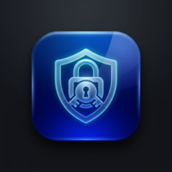

<div align="center">
  
  <h1>EasyPass</h1>
  <p><strong>Next-Generation Cryptographically Secure Password & Passphrase Generator PWA</strong></p>

  <p>
    <a href="https://github.com/"></a>
    <a href="LICENSE"></a>
    <a href="manifest.json"></a>
    <a href="#-cryptography--security"></a>
    <a href="#-technology-stack"></a>
  </p>
</div>

---

## 📖 About EasyPass

**EasyPass** is a modern, privacy-first, client-side password and passphrase generation suite built as an installable **Progressive Web App (PWA)**. It provides enterprise-grade cryptographic security in an elegant, glassmorphic user interface that runs entirely inside your browser—both online and **100% offline**.

### Why EasyPass?
Most online password generators send requests across the network, run analytics scripts, or rely on outdated, biased pseudo-random algorithms (`Math.random()`). 

EasyPass was engineered from the ground up with the following core principles:
1. **Zero Network Footprint**: No servers, no tracking, no Google Analytics, no third-party CDNs. Every single byte of cryptographic material is generated directly in browser memory and stays on your machine.
2. **True Cryptographic Randomness**: Powered by the native Web Crypto API (`window.crypto.getRandomValues()`) paired with rejection sampling to eliminate modulo bias.
3. **Dual Generation Paradigms**: Instant toggle between high-entropy character-based passwords and human-memorable dictionary passphrases.
4. **Install Anywhere as a PWA**: Works natively as a desktop or mobile application on macOS, iOS, Android, Windows, and Linux.

---

## 🌟 Key Features

### 🔑 Dual Generation Engines
- **Classic Complex Password**:
  - Configurable length (4 to 64 characters).
  - Multi-class character selection: Lowercase (`a-z`), Uppercase (`A-Z`), Numbers (`0-9`), and Symbols (`!@#$%...`).
  - Guaranteed minimum character counts per active category with random fill.
- **Memorable Diceware Passphrase**:
  - Generates memorable, high-entropy phrases from bilingual curated dictionaries (256 words each, power-of-two uniform entropy).
  - Configurable phrase length (3 to 10 words).
  - Choice of separators: hyphens (`-`), underscores (`_`), dots (`.`), colons (`:`), semicolons (`;`), commas (`,`), or spaces.
  - Optional title-casing and automatic numeric digit appending.

### 🛡️ Cryptography & Security
- **Web Crypto API & Zero Modulo Bias**: Uses rejection sampling algorithm (`getSecureRandomInt`) to ensure every character or dictionary index has an identical mathematical probability of being selected.
- **Accurate Real-Time Entropy**: Displays real-time entropy calculation in bits ($H = L \cdot \log_2(N)$) alongside an intuitive complexity bar.
- **Strict Content Security Policy (CSP)**: Built-in meta CSP blocks all unauthorized external scripts, inline injection, and network connections.
- **Ninja Privacy Mode**: An instant toggle (`-webkit-text-security: disc`) that masks passwords on screen to prevent shoulder-surfing in public environments.
- **Encrypted Local History**: Saves your last 10 generated passwords locally using PBKDF2/AES encryption, complete with confirmation dialogs for zero accidental data loss.

### ⚙️ Usability & Customization
- **Ambiguous Character Filter**: Exclude visually confusing glyphs (`0/O`, `1/l/I`, `8/B`).
- **Consecutive Character Filter**: Prevent repeated identical characters from appearing adjacently.
- **Custom Exclusion Set**: Blacklist characters prohibited by specific corporate or legacy IT password policies.
- **Multilingual Support**: Real-time toggle between Italian (**IT**) and English (**EN**).
- **Adaptive Dark / Light Themes**: Matches system `prefers-color-scheme` with manual override and OLED-black styling.
- **Haptic & Auditory Feedback**: Tactile vibration on mobile and zero-leak synthesized audio click via Web Audio API.
- **Accessible & Ergonomic**: Full keyboard navigation (press `G` to regenerate, `Esc` to dismiss dialogs), visible focus rings, ARIA roles, and iOS safe area padding.

---

## 📱 Progressive Web App (PWA)

EasyPass is a certified Progressive Web App that works seamlessly offline and can be installed directly onto your device:

- **iOS / iPadOS**: Open Safari, tap the **Share** button, and choose **Add to Home Screen**.
- **Android**: Open Chrome, tap the **three dots menu**, and choose **Install app** or **Add to Home Screen**.
- **macOS / Windows / Linux**: In Google Chrome, Microsoft Edge, or Brave, click the **Install icon** in the browser address bar.

### Service Worker Caching
The application includes a Cache-First Service Worker (`sw.js`) that automatically pre-caches all essential static assets (`index.html`, `manifest.json`, and the `assets/` suite), ensuring instantaneous startup and uninterrupted offline usability.

---

## 📁 Repository Structure

```text
EasyPass/
├── .github/
│   └── workflows/
│       └── deploy.yml        # Automated GitHub Pages CI/CD deployment
├── assets/                   # Consolidated modern PWA & web brand assets
│   ├── apple-touch-icon.png  # Apple iOS touch icon (180x180)
│   ├── favicon-16.png        # Standard web favicon (16x16)
│   ├── favicon-32.png        # Standard web favicon (32x32)
│   ├── favicon.ico           # Multi-resolution favicon fallback
│   ├── icon-192.png          # PWA standard launcher icon (192x192)
│   ├── icon-512.png          # PWA high-res launcher icon (512x512)
│   ├── icon-maskable.png     # Android adaptive / maskable icon (512x512)
│   └── icon.svg              # Scalable vector brand icon
├── .gitignore                # Git exclusions (local caches, OS files, legacy folders)
├── favicon.ico               # Root favicon shortcut
├── index.html                # Single-file standalone PWA application
├── LICENSE                   # MIT Open Source License
├── logo.png                  # High-resolution primary brand logo
├── manifest.json             # W3C Web App Manifest
├── README.md                 # Project documentation & architecture
└── sw.js                     # Offline Service Worker (PWA Cache-First engine)
```

> [!NOTE]
> Legacy working folders (`archive/`, `favicon/`, `graphics/`, `icons/`) have been archived and added to `.gitignore` to keep the public repository lightweight and streamlined.

---

## 🚀 Quick Start & Local Development

Because EasyPass is a self-contained, dependency-free web application, no compilers, bundlers, or package managers are required.

### Run Directly
Open `index.html` in any modern web browser:
```bash
open index.html        # macOS
xdg-open index.html    # Linux
start index.html       # Windows
```

### Run via Local Web Server
To test PWA service workers and manifest registration locally over HTTP:
```bash
# Using Python 3
python3 -m http.server 8000

# Or using Node.js
npx serve .
```
Then visit `http://localhost:8000`.

---

## 🌐 Deploying to GitHub Pages

### Automated GitHub Actions (Recommended)
1. Push this repository to GitHub on the `main` branch.
2. Go to **Settings** > **Pages** in your GitHub repository.
3. Under **Build and deployment** > **Source**, choose **GitHub Actions**.
4. The workflow in `.github/workflows/deploy.yml` will automatically deploy your PWA.

---

## 📜 Changelog

- **v2.1.0** (Current)
  - Consolidated brand identity with new glowing digital shield icon.
  - Streamlined `assets/` directory with standardized PWA launcher, maskable, and favicon icons.
  - Cleaned repository structure and excluded legacy directories via `.gitignore`.
  - Expanded comprehensive **About EasyPass** modal and documentation.
- **v2.0.0**
  - Migrated PRNG to native Web Crypto API (`crypto.getRandomValues`) with zero-modulo-bias rejection sampling.
  - Added full bilingual support (Italian & English) with synchronized UI and dictionaries.
  - Upgraded accessibility, interactive touch targets, and ARIA live regions.
  - Implemented client-side encrypted password history and Ninja privacy mode.
- **v1.97 - v1.0**
  - Historical incremental releases (passphrase mode, dark/light themes, offline manifest).

---

## 🛠️ Technology Stack

- **HTML5 & CSS3**: Responsive CSS variables, glassmorphic layout, safe-area support.
- **Vanilla JavaScript (ES6+)**: Zero runtime dependencies, 100% auditable client-side code.
- **Web Crypto API**: Cryptographic pseudo-random number generation (`crypto.getRandomValues`).
- **Web App Manifest & Service Worker**: Modern offline-first PWA architecture.

---

## 📄 License

Distributed under the [MIT License](LICENSE). Free for personal and commercial use.

---

## 👤 Author & Support

- **Created by**: Stefano Soranzio ([sputlab.com](https://www.sputlab.com))
- **Support the Project**: [PayPal Donation](https://www.sputlab.com/donate)
